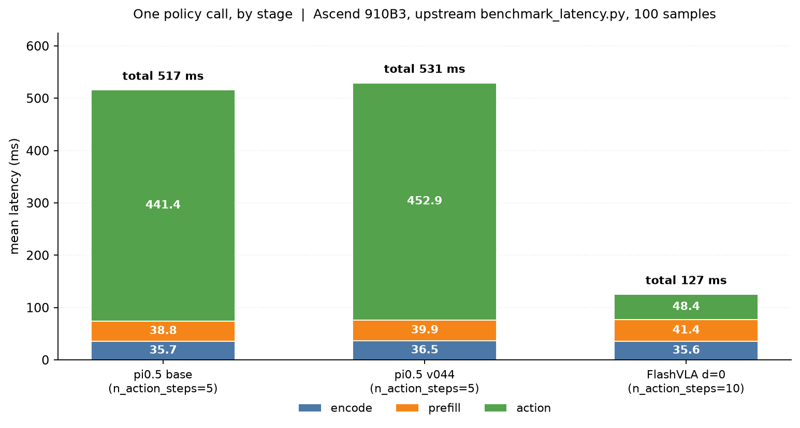
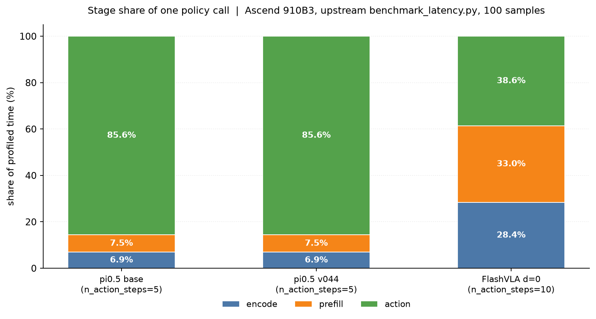

# Reproducing the FlashVLA paper on Ascend NPU

This page records an attempt to reproduce the evaluation set-up of the FlashVLA paper
(arXiv:2608.27384) on Ascend 910B3, **without any Ascend-specific optimisation**. The
goal is a baseline: the shipped code, the shipped checkpoints, the official evaluation
scripts — nothing tuned.

Companion pages: [`ascend.md`](ascend.md) (how to run things) and
[`ascend_baseline.md`](ascend_baseline.md) (the earlier single-checkpoint latency
baseline).

## What "reproduce" means here

| dimension | paper | this reproduction |
|---|---|---|
| LIBERO suites | spatial / object / goal / 10 | same four |
| episodes | 50 per task × 10 tasks × 4 suites = 2000 | same |
| seeds | 5 seeds averaged | **1 seed** (`1000`) — see caveat 5 |
| π0.5 checkpoint | Physical Intelligence π0.5 | `lerobot/pi05_libero_finetuned_v044` + `lerobot/pi05_libero_base` |
| π0.5 replan interval | **5 action steps** (App. A.1) | **5** (`--policy.n_action_steps=5`) |
| FlashVLA checkpoint | `z-lab/flashvla-pi05-libero` | same (local copy) |
| FlashVLA buffer | chunk 10, buffer 4 | same |
| FlashVLA replan horizon | 10 action steps (released config) | 10 — **App. A.1 says 5**; see the P2 note |
| overlap `d` | 0, 1, 2 | same |
| latency harness | `benchmarks/benchmark_latency.py` | same script (Ascend device plumbed in) |
| accuracy harness | `sim_eval/libero/eval.sh` | same script (`POLICY_DEVICE=npu`) |

## Changes to the shipped code

Only device plumbing. Nothing in the model, the sampler or the evaluation logic changed.

| file | change | why |
|---|---|---|
| `benchmarks/benchmark_latency.py` | `+1` line: `import flashvla.npu_support` | the script never registered the `npu` backend, so `--policy.device=npu` was rejected during config parsing |
| `flashvla/policies/pi05/modeling_pi05.py` | `+22/-2`: `_new_timing_event(device)` + device-agnostic `_cuda_sync()` | `profile=True` allocated `torch.cuda.Event`, which raises `RuntimeError: Tried to instantiate dummy base class Event` on a CUDA-less build |
| `flashvla/policies/pi05/modeling_pi05_flashvla.py` | `+24/-3`: same two helpers, 2 event call sites | same |
| `sim_eval/libero/eval.sh` | `+13/-2`: `POLICY_DEVICE` (default `cuda`), and `ASCEND_RT_VISIBLE_DEVICES` instead of `CUDA_VISIBLE_DEVICES` when it is `npu` | CUDA's device mask is ignored on Ascend; without this all workers pile onto chip 0 |

The last one preserves the upstream shell interface: `GPUS="0 1 2 3"` still selects four
workers. On CUDA nothing changes (`POLICY_DEVICE` defaults to `cuda`).

`bench_npu.py`, `run_bench.sh`, `run_eval_generic.sh`, `run_latency_npu.sh` and
`run_precision_npu.sh` are Ascend-side tooling added by this branch, not part of the paper
reproduction.

## P1 — Inference latency (official `benchmarks/benchmark_latency.py`)

Protocol copied from the paper and from the two shipped configs: `num_samples=100`
inputs drawn from `HuggingFaceVLA/libero`, `warmup_steps=10`, `batch_size=1`, `seed=42`,
2 camera views, `num_frames_per_view=1`, internal breakdown enabled
(`compile_model=false` so the per-stage events survive).

| run | checkpoint | variant | `n_action_steps` | mean | median | p95 | fps |
|---|---|---|---|---|---|---|---|
| L-base | `lerobot/pi05_libero_base` | baseline | 5 | **517.20 ms** | 509.16 | 547.88 | 1.933 |
| L-v044 | `lerobot/pi05_libero_finetuned_v044` | baseline | 5 | **530.68 ms** | 524.39 | 566.10 | 1.884 |
| L-flashvla | `flashvla-pi05-libero` | flashvla | 10 | **126.50 ms** | 126.27 | 128.34 | 7.905 |

Per-stage breakdown (mean over the 100 samples, ms):

| run | encode | prefill | action | sum |
|---|---|---|---|---|
| L-base | 35.73 (6.9%) | 38.77 (7.5%) | 441.40 (85.6%) | 515.9 |
| L-v044 | 36.55 (6.9%) | 39.92 (7.5%) | 452.87 (85.6%) | 529.3 |
| L-flashvla | 35.60 (28.4%) | 41.44 (33.0%) | 48.39 (38.6%) | 125.4 |

Two things worth noting:

1. **The speedup is 4.09× and it moves the bottleneck.** FlashVLA's `action` stage is
   48.4 ms instead of 441.4 ms (10 denoising steps collapse into one per chunk), but
   `encode` + `prefill` barely change (74.5 → 77.0 ms) because every chunk still runs a
   full VLM pass. Those two stages go from 14% of the chunk to **61%** of it.
2. **`L-base` and `L-v044` are indistinguishable** (517 vs 531 ms, a 2.6% gap that is
   inside the run-to-run spread of the earlier sweeps). They differ only in weight
   precision — fp32 for `base`, bf16 for `v044` — and the model keeps its norm/embedding
   tensors in fp32 either way, so the denoising loop costs the same. This is expected,
   not a bug.





Both figures are generated from `outputs/benchmarks/npu_latency_*.json` by
`plot_latency_breakdown.py`; the committed copies live in `docs/figs/`.

## P2 — LIBERO accuracy (official `sim_eval/libero/eval.sh`)

Protocol: 50 episodes × 10 tasks × 4 suites = **2000 episodes per group**, one seed
(`1000`), `n_action_steps=10` for FlashVLA (the released checkpoint config) and
`n_action_steps=5` for π0.5 (paper App. A.1, "replans every 5 action steps"). All runs use
the stock `eval.sh` with `POLICY_DEVICE=npu`.

> Status as of **2026-10-26 09:35 CST**. Every group below has finished; the numbers are
> read from the final `eval_info.json` (500 episodes per suite, 10 tasks each).

| run | spatial | object | goal | LIBERO-10 | mean | status |
|---|---|---|---|---|---|---|
| FlashVLA `d=0` | 99.0 | 99.4 | 97.4 | 96.0 | **97.95** | FINAL |
| FlashVLA `d=1` | 95.0 | 100.0 | 95.6 | 95.6 | **96.55** | FINAL |
| FlashVLA `d=2` | 82.0 | 99.0 | 92.4 | 93.4 | **91.70** | FINAL |
| π0.5 `v044` | 98.6 | 98.4 | 96.8 | 91.2 | **96.25** | FINAL |
| π0.5 `base` (extra) | 23.2 | 4.4 | 21.0 | 0.0 | **12.15** | FINAL |

`d=2` final counts: spatial 410/500, object 495/500, goal 462/500, LIBERO-10 467/500
(**1834/2000 = 91.7**). `base` is an extra run of the un-finetuned checkpoint with
borrowed LIBERO normalisation; its near-zero LIBERO-10 rate (0/500, every episode runs to
the 520-step limit) confirms it is not a LIBERO policy and it is not comparable to any
paper row.

### Reference numbers (corrected against the PDF and the checkpoint model card)

The handoff draft's paper rows were mis-transcribed; the authoritative values are:

| reference | spatial | object | goal | LIBERO-10 | mean |
|---|---|---|---|---|---|
| paper π0.5, sync (Table 3) | 98.8 | 98.2 | 98.0 | 92.4 | 96.9 |
| paper FlashVLA `d=0` (Table 3) | 98.6 | 99.0 | 97.8 | 96.2 | 97.9 |
| paper FlashVLA `d=1` (Table 1, 5 runs) | 98.8 | 99.6 | 97.6 | 95.4 | 97.8 |
| **model card** FlashVLA `d=1` | 96.0 | 99.6 | 96.4 | 96.0 | **97.0** |
| paper FlashVLA `d=2` (Fig. 3) | — | — | — | — | **98.3** |

Two caveats on the references themselves: the paper's Fig. 3 gives only the four-suite
average for `d=2` (the per-suite values sometimes quoted are not in the text), and the
released model card disagrees with the paper on `d=1` (97.0 vs 97.8), most visibly on
spatial (96.0 vs 98.8).

### What the numbers say

1. **`d=0` reproduces the paper almost exactly** (97.95 vs 97.9; every suite within
   0.4 points). The checkpoint, the normalisation statistics, the test suite, the seed and
   the measurement path are therefore aligned.
2. **`d=1` matches the model card, not the paper** (96.55 vs 97.0 card / 97.8 paper).
   Per suite we are 0.4–1.0 points from the card and 1.4–4.0 from the paper. With one seed
   and 500 episodes per suite, that is consistent with the card and within single-seed
   scatter of the paper; it does not look like a defect in the async path.
3. **`d=2` is the one genuine divergence** (measured 91.7 vs paper 98.3). See below.
4. **The π0.5 baseline lands where the paper says it should.** `v044` finishes at
   **96.25** (paper 96.9), with LIBERO-10 at 91.2 (paper 92.4). The 0.65 overall gap is
   inside single-seed scatter, so the FlashVLA-vs-π0.5 comparison is on a sound footing:
   synchronous FlashVLA is **+1.7 points** over this baseline (97.95 vs 96.25), close to
   the +1.0 the paper reports.

### Anomaly: `d=2` loses 4–20 points on precision tasks

The loss is not spread evenly. Final per-task counts for the tasks that account for most
of it:

| suite / task | `d=0` | `d=1` | `d=2` |
|---|---|---|---|
| spatial task 1 | 50/50 | 43/50 | **30/50** |
| spatial task 3 | 50/50 | 49/50 | **39/50** |
| spatial task 5 | 50/50 | 42/50 | **28/50** |
| spatial task 8 | 48/50 | 47/50 | **40/50** |
| goal task 2 | 49/50 | 44/50 | **39/50** |
| goal task 3 | 40/50 | 41/50 | **29/50** |
| LIBERO-10 task 6 | 49/50 | 45/50 | **36/50** |
| object (all tasks) | 497/500 | 500/500 | **495/500** |
| LIBERO-10 (all tasks) | 480/500 | 478/500 | **467/500** |

Properties of the failures:

* **Monotonic in `d`** on the same tasks (spatial-1: 50 → 43 → 30; spatial-5: 50 → 42 →
  28; LIBERO-10 task 6: 49 → 45 → 36), so this is a staleness response, not a random
  outlier.
* **Every failed episode runs to the step limit** (280/300/520 steps) — the policy gets
  close and then times out rather than diverging; the passing episodes on the same tasks
  finish in 119–169 steps.
* Failures are **not confined to a few initial states**: they are spread over the 50
  episode indices (e.g. spatial-1 fails at 0,1,3,7,9,11,13,14,16,19,20,24,33,34,36,37,39,
  40,45,49).
* **`d>0` buys no real wall-clock on this host.** Final time per action step is
  613→604→583 ms (spatial), 501→505→498 (goal), 350→349→344 (object) and 388→374→371
  (LIBERO-10) for `d=0→1→2`. The 3–5% apparent gain at `d=2` is an artifact of its longer
  failing episodes — every failed episode runs to the step limit and its cached-action
  steps cost ~0.02 ms instead of ~60 ms — not a genuine speedup. The per-step budget is
  dominated by MuJoCo rendering. So `d=2` pays the staleness cost without the speedup it is
  supposed to buy: in this reproduction the async trade-off is strictly worse.

What we have ruled out: the launch cadence is correct (one inference per 10 executed
steps at every `d`), `eval.py` is unmodified upstream, and the same checkpoint reproduces
`d=0` exactly. The open question is whether the released `d=2` operating point is simply
this fragile on a different arithmetic backend (bf16 NPU vs CUDA), or whether the paper's
`d=2` number was produced with a different execution horizon. Note that App. A.1 says
"the model replans every 5 action steps" while the released checkpoint config (and the
model card) use `n_action_steps=10`; we follow the released config because it reproduces
`d=0`. A `d=2` run with `n_action_steps=5` would be the next thing to check if the
divergence needs to be pinned down.

## Caveats

1. **Framework optimisations are off.** The paper's headline latency runs with kernel
   fusion and CUDA Graph capture enabled (Sec. 3.2: *"we compile each stage into a CUDA
   Graph ... additionally pack linear layers ... apply PyTorch's max-autotune"*). None of
   that exists here: `torch.compile` has no usable backend on this stack (`inductor`
   needs Triton; the Ascend graph compiler `torchair` is not installed with CANN 8.5.0),
   and `fuse_qkv` / `fuse_gate_up` are off because the FlashVLA policy's attention
   `forward` has no `qkv_proj` branch — enabling fusion deletes `q_proj`/`k_proj`/`v_proj`
   without wiring a replacement and segfaults on the first forward pass. So these numbers
   are an **unoptimised** baseline, and only comparable to other numbers measured the same
   way.
2. **Latency is not `Time/Step`.** `Time/Step` is mean episode wall time over executed low
   level steps, **including rendering**. Inference latency is one policy invocation after
   warm-up. The paper says so explicitly in its README. Section "Measured decomposition"
   of [`ascend_baseline.md`](ascend_baseline.md) shows where the rest of the wall clock
   goes on this host (MuJoCo on CPU via llvmpipe: 70–78% of every step).
3. **The paper never reports `Time/Step` for `d=0`.** Its LIBERO table lists `d=1` (22.1 ms)
   and `d=2` (20.6 ms) and leaves `d=0` as a dash; `d=0` accuracy lives in a separate
   table. So there is no paper `d=0` `Time/Step` to compare against — comparing our `d=0`
   wall clock to their `d=1` number would flatter us by construction.
4. **RoboTwin is not attempted here.** `sapien` publishes only `manylinux2014_x86_64` and
   `win_amd64` wheels (checked 2.2.2, 3.0.0.dev0-2, 3.0.0b0-1: no aarch64 wheel and no
   sdist), so the SAPIEN simulator cannot be installed on this aarch64 host. The
   client/server split in [`sim_eval/robotwin/README.md`](../sim_eval/robotwin/README.md)
   would work across machines (SAPIEN on x86, policy server on Ascend) but is out of scope
   for this round.
5. **One seed, 2000 episodes.** With `p ≈ 0.98` the standard error of a 2000-episode mean is
   about `sqrt(0.98 × 0.02 / 2000) ≈ 0.3%`, but episode outcomes are clustered by task
   (10 tasks per suite), so the effective error is closer to `±0.5–1.0` points. Differences
   smaller than that are not meaningful here. The paper averages five runs. The policy's
   sampling noise is seeded once per process (`set_seed(1000)`), not once per episode, so
   the same episode index is **not** the same noise draw in the `d=0`/`d=1`/`d=2` runs;
   only the 500-episode aggregates are comparable, not episode-to-episode outcomes.
6. **`base` accuracy is an extra, not part of the paper protocol.** The un-finetuned
   `pi05_libero_base` was originally measured for latency only; an accuracy run was added
   later (with normalisation statistics borrowed from `v044`, see the handoff notes), so
   its numbers describe the base model and are not comparable to any paper row. Measured:
   mean **12.15**, LIBERO-10 **0/500**.

## Reproduce

```bash
# P1 — latency, one chip each, ~13 min per run (7 min of it is weight loading)
bash run_latency_npu.sh benchmarks/configs/npu_latency_base.yaml      4 L-base
bash run_latency_npu.sh benchmarks/configs/npu_latency_v044.yaml      5 L-v044
bash run_latency_npu.sh benchmarks/configs/npu_latency_flashvla.yaml  6 L-flashvla

# P2 — accuracy, four chips, ~9 h per group
GPUS="0 1 2 3" OUTPUT_ROOT=/home/data/flashvla/logs/paperE/flashvla \
  bash run_precision_npu.sh flashvla_d0 /home/data/flashvla/weights/flashvla-pi05-libero 10 0 50 1000 false false
GPUS="0 1 2 3" OUTPUT_ROOT=/home/data/flashvla/logs/paperE/flashvla \
  bash run_precision_npu.sh flashvla_d1 /home/data/flashvla/weights/flashvla-pi05-libero 10 1 50 1000 false false
GPUS="0 1 2 3" OUTPUT_ROOT=/home/data/flashvla/logs/paperE/flashvla \
  bash run_precision_npu.sh flashvla_d2 /home/data/flashvla/weights/flashvla-pi05-libero 10 2 50 1000 false false
GPUS="0 1 2 3" OUTPUT_ROOT=/home/data/flashvla/logs/paperE/pi05_v044 \
  bash run_precision_npu.sh pi05_v044 /home/data/flashvla/weights/pi05_libero_finetuned_v044 5 0 50 1000 false true

# progress at any time
python progress_repro.py /home/data/flashvla/logs/paperE
```
